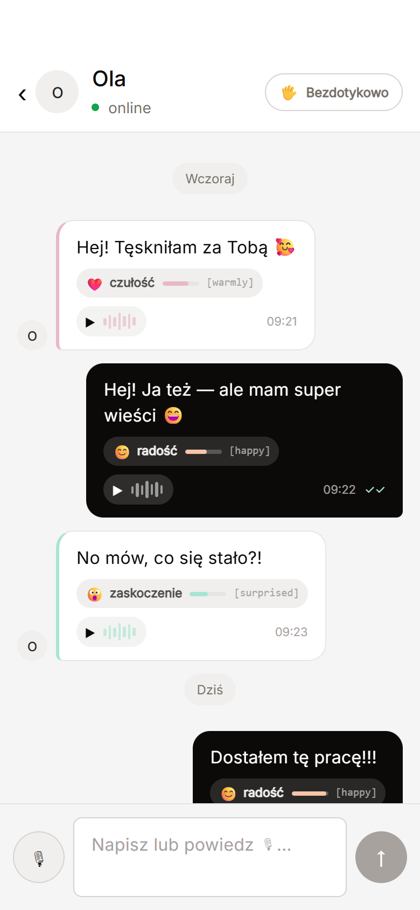
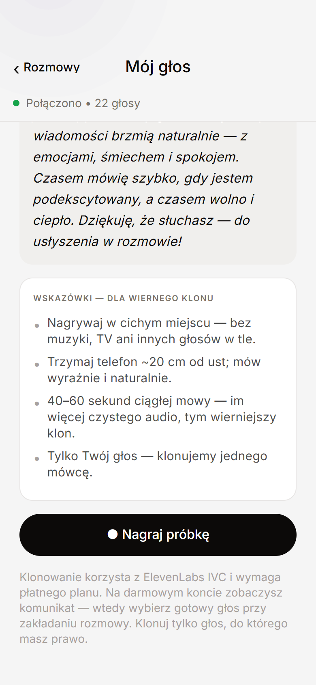
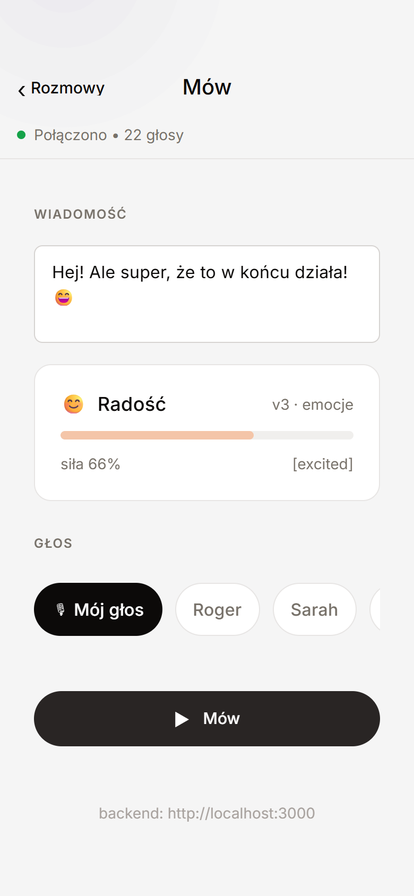

# VoiceThread

A voice-first messenger proof of concept built on the ElevenLabs API: every message can be read aloud in a contact's voice, with the emotion it was written with.

**Status: proof of concept, built in two days (8 to 9 June 2026).** It is a student project that runs from a laptop and Expo Go. It is not a production app and has no accounts, no deployment and no real users. Independent project, not affiliated with or endorsed by ElevenLabs.

## What I did

I am the product owner. I made the product, API and security decisions and set the acceptance criteria; the code was written by AI agents (see "How it was built").

- **Product idea.** Plain text loses tone, so the same "fine" can read as warm or cold. VoiceThread stores an emotion with each message and plays it back in a real voice with that feeling.
- **Chose the ElevenLabs capabilities:** text-to-speech with `eleven_v3` emotion tags (plus `flash` and `multilingual` models), Scribe speech-to-text for dictation, Instant Voice Cloning for "my voice", and the voices list for per-contact voices.
- **Decided the privacy model.** The ElevenLabs key lives only on the backend, which proxies all calls. Emotion is computed on the device for typed text. The relay forwards messages in memory and stores nothing. Text sent for synthesis does reach ElevenLabs, and the docs say so.
- **Asked for cost and abuse controls:** a response cache for synthesized audio, rate limiting on the chat relay, size limits and input validation on the proxy.
- **Required a documented threat model** ([`SECURITY.md`](SECURITY.md)), including the gaps that remain (no TLS or end-to-end encryption by default, unauthenticated pairing codes, no per-client quota on the proxy).

## How it was built

With Claude Code agents. They wrote the code, tests and documentation; I directed the work, reviewed the results and tested the app by hand. The prompts, role definitions and a small monitoring helper I used while working are kept in [`docs/how-it-was-built/`](docs/how-it-was-built/). They are process tools, not features of the product.

## What it does

- Conversations list with local history (SQLite), per-message emotion chip (emoji, label, intensity, the `[happy]`-style tag) and playback in the contact's voice.
- Emotion from text is computed on the device by deterministic rules (emoji, punctuation, per-language lexicons). For dictated messages, an optional local helper in `emotion-service/` reads emotion from the recorded audio with the open-source emotion2vec model.
- Dictation with Scribe and a hands-free mode (auto-read incoming messages, one-tap reply).
- Voice cloning studio (needs a paid ElevenLabs plan; on a free key the app shows a message and falls back to premade voices).
- The UI is in Polish.

| Conversations | Chat | Voice studio | Speak |
|:--:|:--:|:--:|:--:|
|  |  |  |  |

The contacts and messages in the screenshots are demo data.

## Architecture

```
phone A  --message + emotion-->  relay (Socket.IO, in memory)  -->  phone B
phone B  --/api/tts, /api/stt-->  backend (Express, holds the key)  -->  ElevenLabs API
```

- `server.js`: Express proxy for ElevenLabs (TTS, STT, voices, voice cloning) and the Socket.IO relay.
- Response cache keyed by a SHA-1 of voice, model, format, settings and text. Default is in memory with a 30 minute TTL; disk caching is opt-in.
- Rate limiting: per-socket token bucket on relay messages. Message and body size caps, strict validation of voice and model ids, security response headers.
- `voicethread-app/`: Expo (SDK 54) and React Native app.
- `public/index.html`: the original single-file web prototype.

## Stack

Node.js, Express, Socket.IO, React Native with Expo, `expo-audio`, `expo-sqlite`, ElevenLabs API. All written by AI agents.

## Run it locally

```bash
cp .env.example .env     # set ELEVENLABS_API_KEY
npm install
npm start                # backend on http://localhost:3000

cd voicethread-app
npm install
npx expo start           # open in Expo Go on a phone on the same Wi-Fi
```

`npm test` runs the backend, theme and emotion tests. They never call ElevenLabs.

## Limitations

- Voice cloning needs a paid ElevenLabs plan.
- Fully hands-free listening needs a development build; Expo Go supports auto-read and one-tap reply.
- Text and audio sent for synthesis or transcription are processed by ElevenLabs under their terms; this proof of concept is not configured for zero retention.
